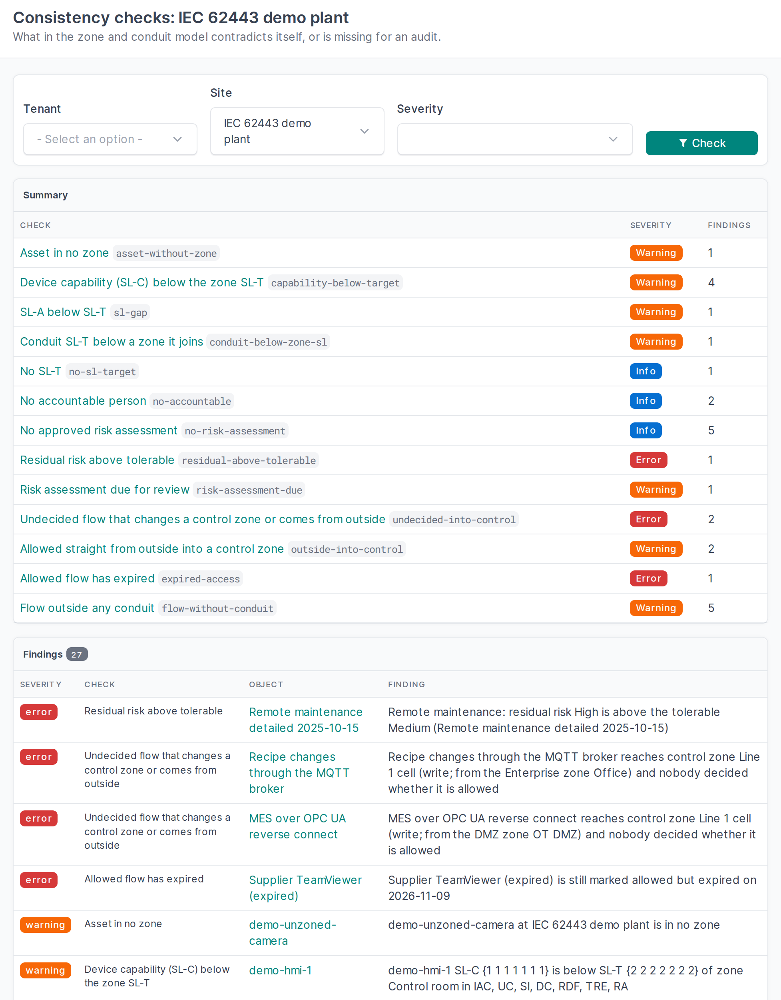
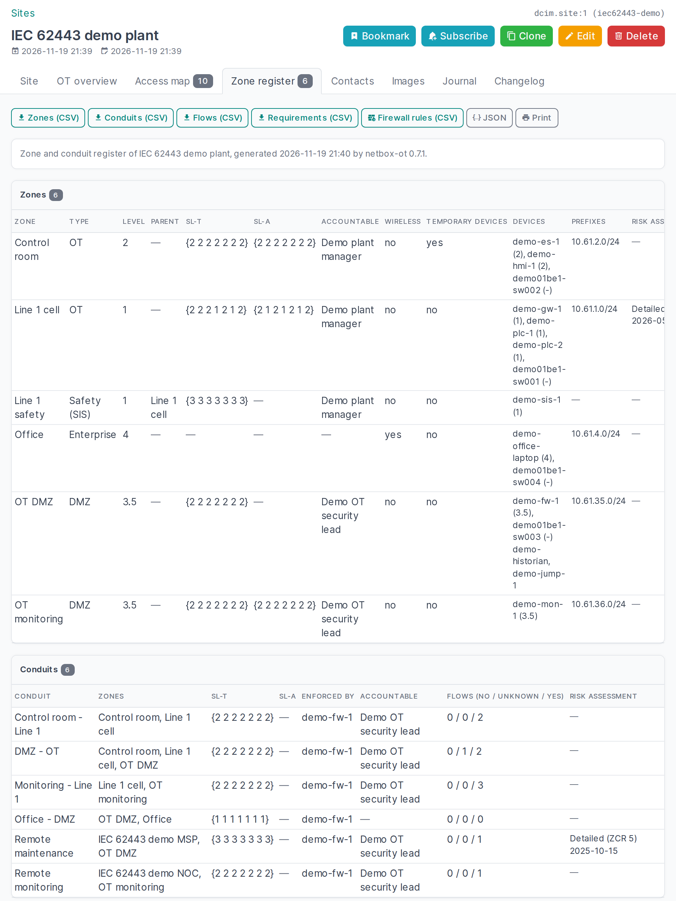

# Consistency checks and the zone register

## Consistency checks

*OT > Consistency checks* lists what is inconsistent or missing in the model of a site, starting with what
exposes the controllers:

- **`undecided-into-control`** (error): a flow into a control zone (Purdue level 0 or 1, or a safety zone) that
  writes, controls or programs it or may (its access includes *unclassified*: requests the import could not
  classify, see [Unclassified requests](access-map.md#unclassified-requests)), is remote access, or comes from a DMZ, enterprise or external zone (or a zone
  at level 3.5 or higher), and that nobody has decided on yet. After a first import these are the flows to
  decide first; a CI job with the default `--fail-on error` fails until they are decided.
- **`outside-into-control`** (warning): a flow that is allowed straight from a DMZ, enterprise or external zone
  into a control zone, without passing a supervisory zone. Allowed by a person, so not an error, but worth a
  look at every review.

Then:

- an address in another zone's prefix, an asset below its zone's level or in the wrong kind of zone, assets
  in no zone or in two;
- SL-A below SL-T, member SL-C below the zone's SL-T, a conduit below a zone it joins, conduits nobody
  enforces;
- expired or open-ended remote access, flows outside any conduit, writes through a broker without their
  topics, verdicts without a decider, stale flows;
- residual risk above tolerable (unless the asset owner accepted it, then an info finding until the acceptance
  ends), overdue risk assessments, a risk lower than its worst threat scenario, an SL-T that differs from what
  the approved risk assessment arrived at
  ([Risk assessments](risk-assessments.md#outcome-sl-t-and-accepting-a-residual-risk));
- IEC 62443-3-3 requirements that apply at the SL-T without a status, and an SL-A claimed with a requirement
  not met ([System requirements](requirements.md));
- what an audit will ask for and is missing: no SL-T, no accountable person, no approved risk assessment
  (not for external zones: a supplier, an MSP or the internet is outside the system under consideration);
- with [netbox-lifecycle](companions.md#end-of-support): devices past, or within a year of, their end of
  support in zones with SL-T 2 or more.

Each finding has a check id, a severity (error, warning, info), a message and the object it is about.

From the API and the command line:

- `GET /api/plugins/ot/checks/?site_id=<id>[&severity=error,warning][&check=<id>,...]`: the findings of a
  site. Needs `view_zone`.
- `manage.py ot_check [--site <slug>] [--tenant <slug>] [--severity ...] [--check ...]
  [--fail-on error|warning|info|never] [--json]` runs the same checks and exits with status 1 when there is a
  finding at `--fail-on` or worse (default: error), so a nightly job or a CI pipeline can watch the model.

The checks page and `ot_check` also take a **tenant**: then only the zones of that tenant (on every site, or on
the site given), the conduits that join one of them and the flows that start or end in one of them are checked.
An MSP or integrator looks after several customers this way.

## Risk register

*OT > Risk and requirements > Risk register* lists every zone and conduit in scope with where its risk stands, worst
first. Filter it by tenant, by site, or both; a tenant also has an *OT risk register* tab. It is printable and
exported as CSV.

| Status | When |
|---|---|
| Above tolerable | The latest approved assessment has a residual risk above its tolerable risk |
| Accepted above tolerable | As above, but the asset owner accepted it and the acceptance has not ended (its end date is shown) |
| No approved assessment | No approved assessment yet; a draft in progress is shown with the step it is at, else an *Assess* button starts an initial one |
| Review due | Approved and within tolerable, but the next review date has passed |
| Within tolerable | Approved, within tolerable and not due |

Per row: the assessment (and a newer one in progress), its step, the unmitigated, residual and tolerable risk, the
next review, the ways in (flows into the zone or carried by the conduit, with how many are remote access) and the
errors and warnings of the checks on the zone or conduit and what is in it. External zones (a supplier, the
internet) are outside the system under consideration and not listed; a conduit is listed for a tenant when it joins
one of the tenant's zones.

## Zone register

The *Zone register* tab on a site is the audit deliverable: the site's zones, conduits and flows with their
security levels, owners, risk and verdicts, plus the check results. It is printable, and exported as CSV per
table or as JSON.

With [system requirements](requirements.md) recorded, the register also lists, per zone and conduit, the
requirements that apply at its SL-T (missing statuses highlighted) and any other requirement with a status, with
its own CSV.

`GET /api/plugins/ot/register/?site_id=<id>` returns the same register as JSON. Needs `view_zone`.
