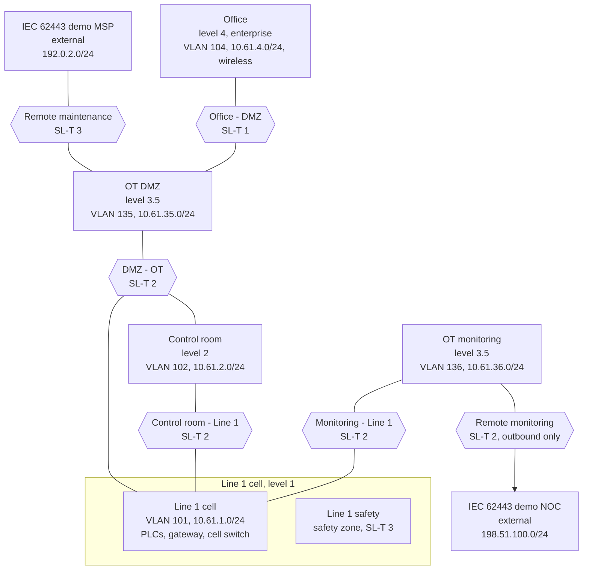
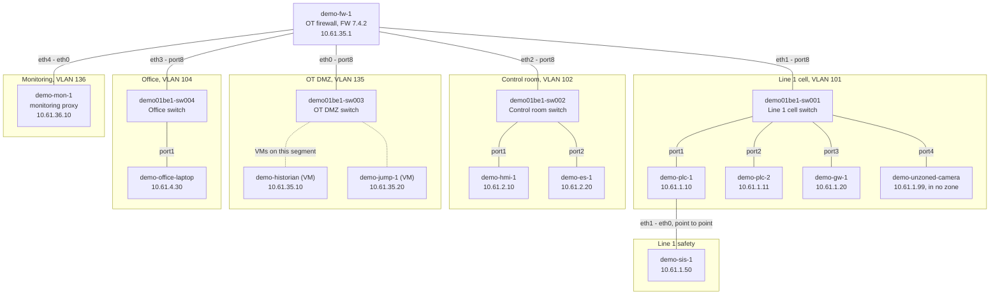
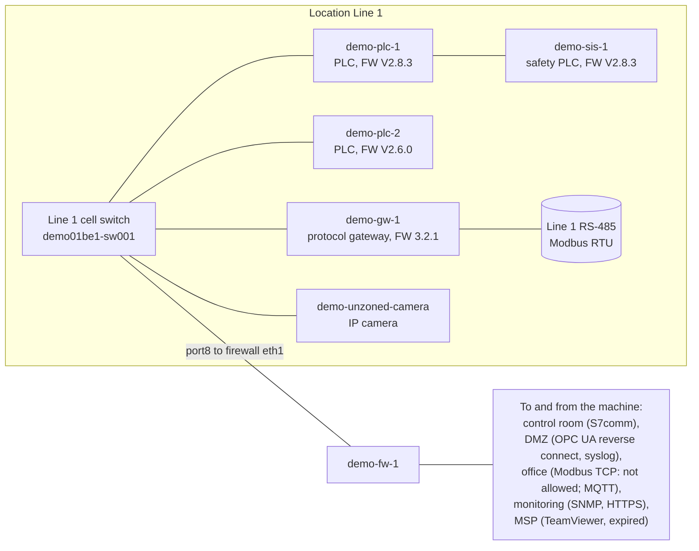
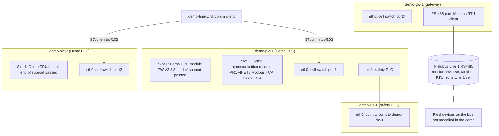
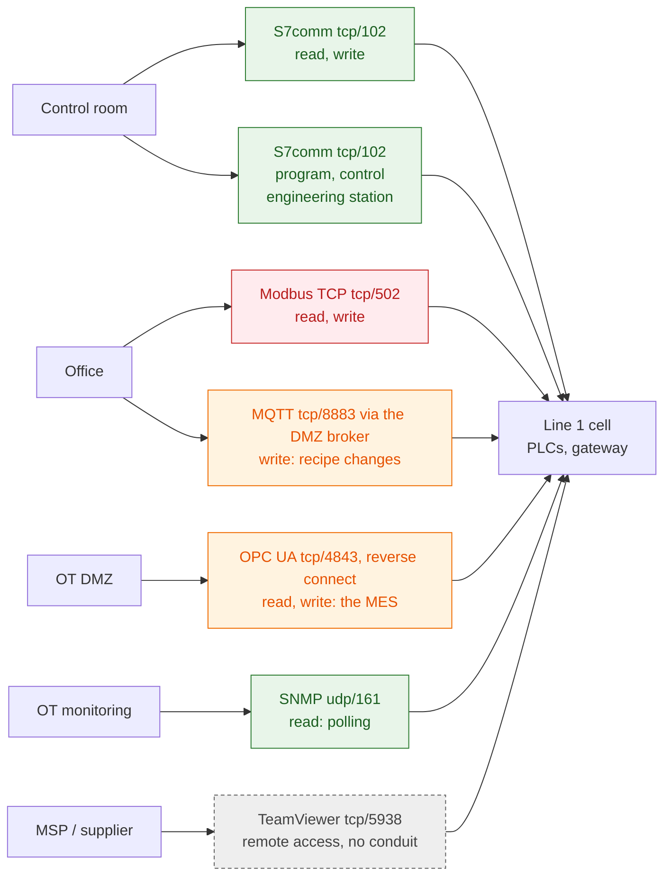
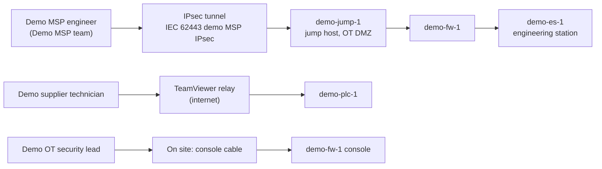
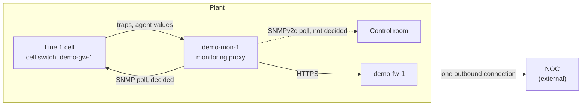
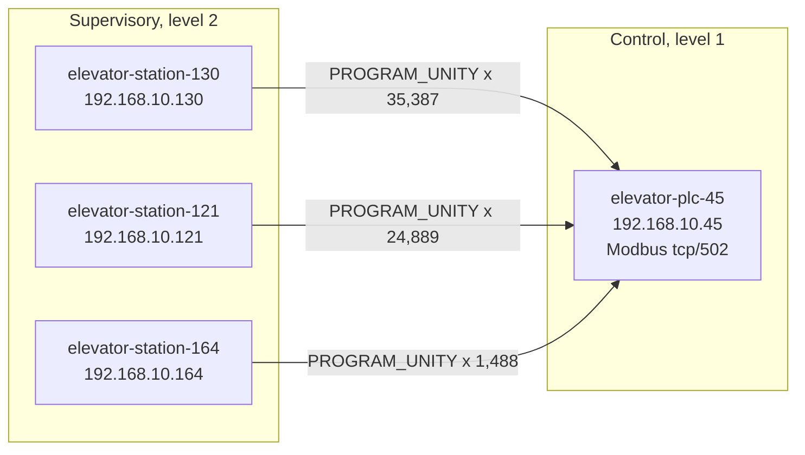

# The demo plant

[netbox-ot.packetflow.be](https://netbox-ot.packetflow.be) is a public NetBox with netbox-ot and its companion
plugins, filled with a fictional plant. Log in as **demo** / **demo**. You can change anything: the whole
database is reset every two hours, so do not enter real data.

This page describes what is in it, level by level, and what each part is there to show. Everything comes from
generators, so you can build the same plant in your own NetBox:

| Layer | Generator | Public demo |
|---|---|---|
| The plant: zones, conduits, devices, cabling, flows, services, fieldbus, risk assessments, requirement statuses | `manage.py ot_demo` ([ot_demo.py](../netbox_ot/management/commands/ot_demo.py)) | yes |
| Modules, lifecycle dates, support contracts, licences, purchases, assets, spare parts, more requirement statuses, access paths | Packetflow's `netbox-demo-populate.py` (through the REST API, needs netbox-lifecycle, netbox-inventory and netbox-access-paths) | yes |
| Saved topology views | Packetflow's NetBox role (saved filters for netbox-topology-views) | yes |
| A site from a real capture: the DFRWS 2023 elevator | `manage.py ot_demo --capture` ([demo_capture.py](../netbox_ot/demo_capture.py)) | from 0.8.0 |
| A large plant: 35 zones, about 200 flows, no devices | `manage.py ot_demo --large` ([demo_large.py](../netbox_ot/demo_large.py)) | no |

All names, addresses and serial numbers are invented. The addresses for the MSP and NOC are documentation
ranges (192.0.2.0/24, 198.51.100.0/24).

## Contents

1. [The plant at a glance](#the-plant-at-a-glance)
2. [Level 1: zones and conduits](#level-1-zones-and-conduits)
3. [Level 2: the network](#level-2-the-network)
4. [Level 3: the machine, Line 1](#level-3-the-machine-line-1)
5. [Level 4: the controllers and the field](#level-4-the-controllers-and-the-field)
6. [Who talks to what: the flows](#who-talks-to-what-the-flows)
7. [Remote access](#remote-access)
8. [Monitoring](#monitoring)
9. [Lifecycle, inventory and spare parts](#lifecycle-inventory-and-spare-parts)
10. [Risk assessments and requirements](#risk-assessments-and-requirements)
11. [What is wrong on purpose](#what-is-wrong-on-purpose)
12. [The capture site: DFRWS 2023 elevator](#the-capture-site-dfrws-2023-elevator)
13. [The large plant](#the-large-plant)
14. [Where to look](#where-to-look)

## The plant at a glance

Site **IEC 62443 demo plant**: one production line (*Line 1*) with two PLCs, a safety PLC and a protocol gateway,
a control room with an operator panel and an engineering station, an OT DMZ with a historian and a jump host,
the office, a monitoring proxy, and two outside parties: the MSP that maintains the SCADA servers and the NOC that
receives the alarms. One OT firewall sits between all of them.

| | Count |
|---|---|
| Zones | 8 (6 on site, 2 external) |
| Conduits | 6, all enforced by the firewall |
| Devices | 14 (plus 2 virtual machines) |
| Cables | 13 |
| Flows | 15 |
| Fieldbuses | 1 |
| Modules | 3 |
| Risk assessments | 4 |

## Level 1: zones and conduits

The zones (boxes) by Purdue level, and the conduits (hexagons) between them, with their target security level
(SL-T). The firewall demo-fw-1 enforces every conduit.

| Zone | Level | Type | Members | Security levels (FR1 to FR7) |
|---|---|---|---|---|
| Line 1 cell | 1 | OT | demo-plc-1, demo-plc-2, demo-gw-1, cell switch | target 2,2,2,1,2,1,2; achieved 2,1,2,1,2,1,2 |
| Line 1 safety | 1 | safety, inside the cell | demo-sis-1 | target 3 on every FR |
| Control room | 2 | OT | demo-hmi-1, demo-es-1, control room switch | target and achieved 2 |
| OT DMZ | 3.5 | DMZ | demo-fw-1, VMs demo-historian and demo-jump-1, DMZ switch | target 2 |
| OT monitoring | 3.5 | DMZ | demo-mon-1 | target and achieved 2 |
| Office | 4 | enterprise | demo-office-laptop, office switch | none set |
| IEC 62443 demo MSP | | external | (a prefix only) | |
| IEC 62443 demo NOC | | external | (a prefix only) | |

The conduits: *Control room - Line 1*, *DMZ - OT* (DMZ, control room and cell), *Office - DMZ*, *Remote
maintenance* (MSP and DMZ), *Monitoring - Line 1* and *Remote monitoring* (monitoring and NOC, outbound only).
demo-fw-1 enforces all six.

## Level 2: the network

What is cabled to what. Every zone has its own switch on its own firewall port, so every conduit passes a
firewall rule. Each switch has eight access ports in its zone's VLAN; port 8 is the uplink.

- The historian reads the gateway through a **1:1 NAT** on the firewall: 10.61.35.120 in the DMZ is
  demo-gw-1's 10.61.1.20 (NetBox's own NAT inside/outside on the IP address).
- The safety PLC is not on the cell switch: it has a dedicated link to demo-plc-1's second port.
- The IP camera is cabled to the cell switch but belongs to no zone: a finding (*asset without zone*).
- Cables are coloured per zone, so the topology view shows the zones in the cabling.

## Level 3: the machine, Line 1

*Line 1* is a NetBox location: what sits in the machine's cabinets. It is what the machine drawing draws (the
*Machine drawing* tab of the location), for the technical file of the Machinery Regulation.

What leaves the machine is every flow from or to *Line 1 cell* (see [the flows](#who-talks-to-what-the-flows));
the drawing lists them under the machine, with the devices, cables, addresses and firmware.

## Level 4: the controllers and the field

Inside the controllers, and below them.

| Controller | Type | Firmware | Industrial services | Modules |
|---|---|---|---|---|
| demo-plc-1 | Demo PLC (SL capability 2,2,2,1,2,1,1) | V2.8.3 | S7comm server, tcp/102 | CPU (slot 1), communication module (slot 2) |
| demo-plc-2 | Demo PLC | V2.6.0, one release behind | S7comm server, tcp/102 | CPU (slot 1) |
| demo-sis-1 | Demo PLC as safety PLC | V2.8.3 | | |
| demo-gw-1 | Demo industrial PC as protocol gateway | 3.2.1 | Modbus RTU client on the RS-485 fieldbus | |
| demo-hmi-1 | Demo HMI panel (SL capability 1) | V15.1 | S7comm client | |

**Sensors and actuators.** The demo stops at the fieldbus: the RS-485 Modbus RTU bus behind the gateway is in
NetBox, with the gateway as its client, but the instruments, drives and I/O on it are not modelled as devices.
The cell's description says what it holds (*PLCs and drives of production line 1*), and the gateway's monitoring
agent sends the values it reads from the bus to the monitoring proxy. The large plant has zones for field
instruments (*Tank farm instruments*, *Packaging sensors*), without devices.

## Who talks to what: the flows

Fifteen flows, as a two-week passive capture on a SPAN port of the OT core switch would show them. Each has a
decision: allowed (*yes*), not allowed (*no*) or not decided yet (*unknown*).

The seven flows into the line, the ones that reach the controllers. Green is allowed, red is not allowed, orange
is not decided yet, grey is allowed but expired.

All fifteen:

| From | To | Protocol, port | Access | Decision | Note |
|---|---|---|---|---|---|
| Control room | Line 1 cell | S7comm tcp/102 | read, write | yes | review in 180 days |
| Control room | Line 1 cell | S7comm tcp/102 | program, control | yes | *Engineering station program* |
| OT DMZ | Control room | OPC UA tcp/4840 | read | yes | |
| Office | Line 1 cell | Modbus TCP tcp/502 | read, write | **no** | the office laptop writing to the line: should not exist |
| Office | Control room | SMB tcp/445 | | undecided | found in the capture, nobody knows why |
| MSP | OT DMZ | RDP tcp/3389 | | yes | remote access; IPsec tunnel, jump host, firewall; expires in 30 days |
| MSP | Line 1 cell | TeamViewer tcp/5938 | | yes, **expired** | the supplier's TeamViewer, expired 10 days ago, no conduit |
| Line 1 cell | OT DMZ | syslog udp/514 | | yes | |
| OT DMZ | Line 1 cell | OPC UA tcp/4843 | read, write | undecided | MES over OPC UA reverse connect: the gateway opens the connection |
| Office | Line 1 cell | MQTT tcp/8883 | write | undecided | recipe changes through the broker in the DMZ, topic `spBv1.0/line1/DCMD/demo-gw-1` |
| OT monitoring | Line 1 cell | SNMP udp/161 | read | yes | SNMPv3, read-only view |
| Line 1 cell | OT monitoring | SNMP udp/162 | | yes | traps from the cell switch |
| Line 1 cell | OT monitoring | HTTPS tcp/443 | | yes | the gateway's monitoring agent |
| OT monitoring | Control room | SNMP udp/161 | read | undecided | SNMPv2c with the default community |
| OT monitoring | NOC | HTTPS tcp/443 | | yes | one outbound connection, through demo-fw-1 |

The *Access map* tab of the site draws these by level, with the flows that change a controller (write, control,
program, or requests nobody could classify) as heavy arrows.

## Remote access

Three ways into the plant, recorded both as flows (above) and as access paths (netbox-access-paths), so the
machine drawing and the access map show who can reach what.

| Access path | Holder | Method | Authentication | Status |
|---|---|---|---|---|
| MSP maintenance: engineering station | Demo MSP engineer, Demo MSP team | RDP through the jump host | MFA | active, expires in 30 days |
| Supplier remote support: PLC 1 | Demo supplier technician | vendor remote tool | shared account | still active, expired 10 days ago, review overdue |
| Break-glass: firewall console | Demo OT security lead | console | password in a sealed envelope | break glass |

## Monitoring

The plant is watched from outside without anything outside reaching in: the monitoring proxy has its own firewall
port, polls the line, receives its traps and agent data, and forwards everything to the NOC over one outbound
connection.

## Lifecycle, inventory and spare parts

Added through the API by the populate layer (netbox-lifecycle and netbox-inventory). Dates are relative to the
day the demo was built, so there is always one passed end of support, one within a year and a contract about to
run out.

| Item | End of sale | End of support | Note |
|---|---|---|---|
| Demo PLC (device type) | passed | in about 200 days | phase-out announced |
| Demo HMI panel | passed | **passed** (about 120 days ago) | no security fixes any more |
| Demo CPU module (module type) | passed | **passed** (about 30 days ago) | the PLC racks are supported longer than their CPUs |
| Demo communication module | in about 300 days | in about 4 years | current |
| Demo OT firewall | in about 2 years | in about 7 years | current |
| Demo industrial PC | passed | in about 3 years | |

- **Support contracts:** the firewall's runs out in 90 days (renewal due in 60); the PLCs' expired 40 days ago and
  covers demo-plc-1, demo-plc-2 and demo-sis-1.
- **Licences:** the SCADA runtime on demo-historian; the engineering suite with two seats on demo-es-1.
- **Purchases:** the line build (closed), the firewall and spares (closed), and an open order for replacement CPU
  modules, placed after the end-of-support notice.
- **Assets:** one per device and module, with serial numbers and warranty dates; in the *Spare parts cabinet*: two
  spare PLCs (firmware V2.6.0) and three 24 V DC power supplies; one retired operator panel.

## Risk assessments and requirements

| Assessed | Kind | Status | Unmitigated | Residual | Tolerable |
|---|---|---|---|---|---|
| Line 1 cell | detailed | approved | high | medium | medium |
| Remote maintenance (conduit) | detailed | approved, **review overdue** | critical | **high** | medium |
| Control room | initial | | high | | medium |
| Office | initial | | medium | | |

IEC 62443-3-3 requirement statuses (the plugin ships the identifiers; the texts and levels come from your own copy
of the standard):

| Zone | Met | Compensated | Not met | Not applicable |
|---|---|---|---|---|
| Line 1 cell | SR 5.1 | SR 5.2 | SR 1.13 (the supplier's TeamViewer reaches the PLCs) | |
| Control room | SR 1.1, SR 2.1, SR 7.3 | SR 1.2 | SR 3.2 (no malware protection on the engineering station) | |
| OT DMZ | SR 5.2, SR 6.1 | | | |
| Line 1 safety | SR 5.1 | | | SR 1.13 |

## What is wrong on purpose

The demo is built so that *OT > Consistency checks* and the site's *OT overview* have something to find:

- the office laptop writes Modbus to the line, a flow decided *not allowed*;
- the supplier's TeamViewer to PLC 1 expired 10 days ago, has no conduit, and its access path is still active;
- SMB from the office to the control room, MQTT recipe writes from the office, OPC UA reverse connect from the MES
  and SNMPv2c polling of the control room are not decided;
- the IP camera on the cell switch is in no zone;
- the remote-maintenance conduit's residual risk is above tolerable and its review is overdue;
- the cell's achieved security level is below target on FR 2 (use control);
- the HMI panel and the PLCs' CPU modules are past end of support, the PLC support contract has expired, and
  demo-plc-2 runs older firmware than demo-plc-1;
- SR 1.13 and SR 3.2 are not met.

## The capture site: DFRWS 2023 elevator

From netbox-ot 0.8.0, `ot_demo --capture` adds a second site, **Elevator (DFRWS 2023 capture)**, imported from a
real network trace rather than invented: the [DFRWS 2023 Forensic Challenge "The Troubled
Elevator"](https://github.com/dfrws/dfrws2023-challenge) (DFRWS; Security and Forensics Engineering Lab,
Virginia Commonwealth University; Apache-2.0). The trace went through Malcolm's Zeek and netbox-ot's importer
(see [Malcolm](malcolm.md)); what ships is aggregated requests only, described in
[NOTICE.md](../netbox_ot/data/demo/dfrws-2023-elevator/NOTICE.md). Device names and roles are ours.

In two hours (29 June 2023, 18:27 to 20:27 UTC) three stations send 61,764 Schneider UMAS requests (Modbus
function 90, *PROGRAM_UNITY*) to the PLC: an engineering channel that can read and change the controller's
program. No table classifies UMAS functions yet, so the flow is **unclassified**, the access map draws it as a
flow that may change the controller, and `ot_check` reports it as an undecided flow into a control zone until
someone decides it. The other hosts in the subnet (DHCP, name resolution) stay in *Elevator cell*.

## The large plant

`ot_demo --large` (not on the public demo) creates a plant of 35 zones and about 200 flows without devices, to
see the access map and the lists at the size of a real site: three production lines, each with a control room,
a cell, robots and a safety zone; utilities (boiler house, compressed air, water treatment); field instrument
zones (tank farm instruments, packaging sensors); MES, site historian, engineering and OT management; four DMZ
zones (historian mirror, remote access, patch and antivirus, MQTT broker); office, ERP, IT management and guest
Wi-Fi; and outside parties (internet, corporate WAN, MSP, robot supplier, boiler supplier).

## Where to look

| To see | Open |
|---|---|
| Where the site stands | the site, tab *OT overview* |
| Who can change the controllers | the site, tab *Access map* |
| The zone register for an audit | the site, tab *Zone register* |
| The machine drawing | location *Line 1*, tab *Machine drawing* |
| Everything the checks find | *OT > Consistency checks* |
| The cabling | *Topology* with the saved views *Demo plant: whole control network*, *PLCs, HMI and how they connect*, *PLCs and their neighbours*, *way in (firewall, gateways, laptops)* |
| End of support and contracts | *Lifecycle > Hardware* and *Support contracts* |
| Assets and spare parts | *Inventory > Assets* |
| Who can get in from outside | *Access paths* |
