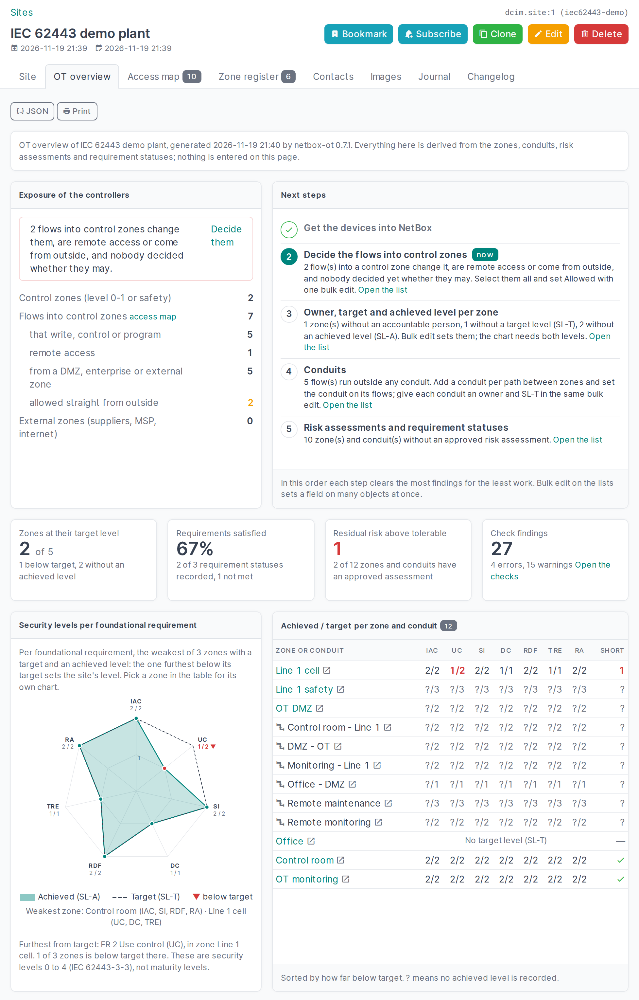

# OT overview

Every site with zones has an *OT overview* tab: where the site stands, on one page you can print. Nothing is
entered here. It is all derived from the zones, conduits, risk assessments and requirement statuses, so it is
as good as what is recorded there.

A site without zones that has devices or VMs with an address or a Purdue level gets the tab too, with only a
*Where to start* card: import a capture (`ot_import --suggest-zone-map` drafts the zone map) or add the zones by
hand, then open the checks. The checks of that site already list its devices under `asset-without-zone`.

## Exposure of the controllers and next steps

The first two cards need no levels or assessments, so they say something from the first import on.

*Exposure of the controllers* counts the control zones (Purdue level 0 or 1, or a safety zone) and the flows
into them: how many write, control or program, are remote access, come from a DMZ, enterprise or external zone,
or are allowed straight from outside, and how many external zones the site has. A red banner gives the number
of flows into a control zone that change it, are remote access or come from outside, and that nobody decided
on yet, with a link to exactly those flows. These are the conditions of the checks `undecided-into-control` and
`outside-into-control`.

*Next steps* lists what to record next, in the order that clears the most findings for the least work:

1. the devices: zones without devices or VMs (`ot_import --unknown-import` writes the files for NetBox's import
   pages);
2. a verdict on the flows into control zones that change them, are remote access or come from outside;
3. an accountable person, a target level and an achieved level per zone (the radar chart needs both levels);
4. conduits for the flows that run outside any conduit;
5. risk assessments and requirement statuses.

Each step says how many objects are left and links to the list of them, where one bulk edit sets a field on
all of them. Step 4 makes the finding count go up before it goes down: every new conduit needs an owner, an
SL-T and a risk assessment of its own (three `info` findings). Select the new conduits in the conduit list and
set the owner and SL-T in one bulk edit; the risk assessments follow in step 5. The first open step is marked *now*; a step with nothing left is ticked. External zones (a
supplier, an MSP, the internet) are outside the system under consideration: they count as exposure, never as
missing paperwork.

The headline cards below show "—" instead of 0 while there is nothing to count: no zone with a target level,
no requirement status, no approved risk assessment.

## Security levels per foundational requirement

The radar chart has one spoke per foundational requirement of IEC 62443 (IAC, UC, SI, DC, RDF, TRE, RA). The
dashed outline is the target level (SL-T), the filled shape the achieved level (SL-A). Where the shape stays
inside the outline, the site is below target; those spokes are marked in red with their numbers.

- For the site, each spoke shows the weakest zone in that foundational requirement: of the zones that have a
  target and an achieved level, the one furthest below its target (then the one with the lowest achieved
  level). Security levels are whole numbers, and an attacker picks the weakest zone, so the site is never an
  average. The line under the chart names the zone behind each spoke, and the text names the foundational
  requirement furthest from target, in which zone, and how many zones are below target there.
- Pick a zone in the table next to it for the chart of that zone alone.
- The outer ring is the highest level drawn (at least SL 2), so a plant with SL-T 2 fills the chart.

The table lists every zone and conduit as achieved/target per foundational requirement, sorted by how far
below target it is: first what is below target, then what has a target but no achieved level yet (`?`), then
what has no target, and last what is at target. *Short* is the number of levels short of target, summed over
the seven foundational requirements.

These are security levels (0 to 4, IEC 62443-3-3), not maturity levels. An average hides a weak zone behind
strong ones: read the chart for the shape and the table for the zone.

## Requirement statuses

Per foundational requirement: how many [system requirements](requirements.md) are met, met by a compensating
countermeasure, not applicable or not met, over all zones and conduits of the site. *Satisfied* counts the
first three. *No status* is a requirement that applies at the target level and has no status yet; the plugin
only knows that once you have loaded the levels from your own copy of the standard.

## Risk, before and after countermeasures

From the latest approved risk assessment of each zone and conduit: how many sit at each risk level before
countermeasures (unmitigated) and after (residual), which still have a residual risk above the tolerable
risk, and which have no approved assessment at all. The levels are the assessor's, by the method named on the
assessment; the overview only counts them.

## Check findings

The number of [consistency check](checks-and-register.md) findings for the site, with a link to them.

## As data

`GET /api/plugins/ot/overview/?site_id=<id>` returns the same numbers as JSON (add `&zone_id=<id>` for one
zone's levels). It needs the `view_zone` permission and counts only what the token's user can view.
