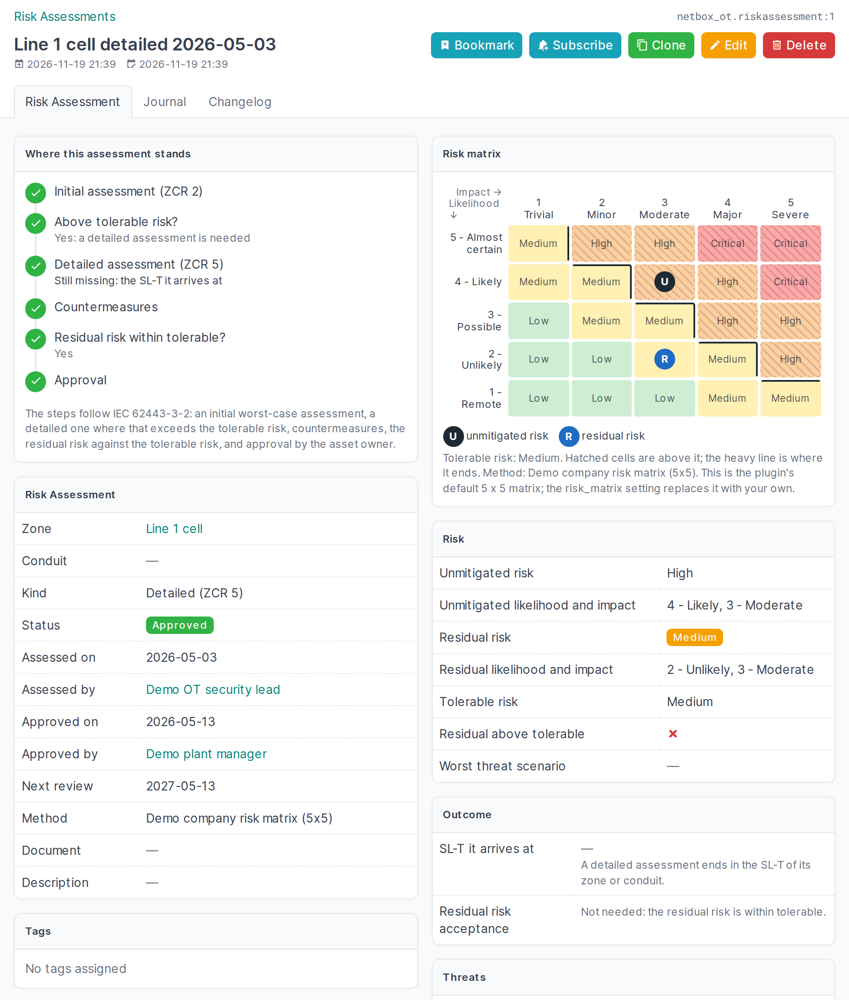

# Risk assessments



A risk assessment (IEC 62443-3-2) belongs to a zone or a conduit: the initial, worst-case one (ZCR 2) or the
detailed one (ZCR 5), with the unmitigated, residual and tolerable risk as low, medium, high or critical. A zone
or conduit keeps every assessment; the latest approved one counts for the register and the checks. This page
is about the two visual aids on the assessment's page.

## Where this assessment stands

The first panel lists the steps of an assessment and marks the one this assessment is at:

| Step | Done when |
|---|---|
| Initial assessment (ZCR 2) | The unmitigated (worst case) risk is recorded, here or in an initial assessment of the same zone or conduit |
| Above tolerable risk? | Unmitigated and tolerable risk are both recorded. If the unmitigated risk is within the tolerable risk, the next three steps are not needed |
| Detailed assessment (ZCR 5) | Threats are recorded (vulnerabilities, consequences, likelihood and impact stay listed as missing until they are filled in). On an initial assessment: a detailed assessment of the same zone or conduit exists (a button starts one) |
| Countermeasures | The countermeasures are recorded |
| Residual risk within tolerable? | The residual risk is recorded and not above the tolerable risk. If it is above, the step asks for a decision: more countermeasures, or an explicit acceptance |
| Approval | Status *Approved* with a date and who approved it |

Under the step it is at, it says what is still missing, with a button to move on:

| The assessment is at | Button |
|---|---|
| A step with something missing | *Fill in: ...* opens the edit form at the first missing field |
| Detailed assessment, on an initial one | *Start the detailed assessment*: a new detailed assessment of the same zone or conduit, with the tolerable risk, method and the initial likelihood and impact filled in |
| Residual risk above tolerable | *Add countermeasures*, *Update the residual risk* or *Accept the residual risk* (today's date filled in) |
| Approval | *Approve* opens the form with status *Approved* and today's date filled in; you add who approved it and the next review |

The buttons need the permission to change (or, for a new detailed assessment, to add) risk assessments.

The list of risk assessments has a *Step* column with the same step, so you can see which assessments are waiting
for what; the API has it as the read-only `current_step`. The first column of the list opens the assessment.

## Threat scenarios

A detailed assessment (ZCR 5) is built from threat scenarios: who or what (the **threat source**) comes in how
(the **entry flow** or conduit), against what (the **target assets**), using which vulnerability, with which
consequence. *Add a scenario* on the assessment starts one; the pickers only offer the flows, devices and
requirement statuses of the assessment's zone or conduit. For remote maintenance, pick the supplier's flow into
the zone as the entry flow: the scenario's *Way in* panel then shows how it comes in (from where, the service,
read/write/program, remote access, the verdict and its expiry).

Each scenario has its own likelihood and impact before and after countermeasures, placed on the same risk matrix
against the assessment's tolerable risk. Its countermeasures can point at the IEC 62443-3-3 requirement statuses
that carry them.

- With scenarios, the detailed step counts as done, and lists the scenarios that have no unmitigated risk yet; the
  countermeasures step is done when the assessment or one of its scenarios has countermeasures.
- The assessment's *Risk* panel shows the **worst threat scenario** (unmitigated and residual). Record the
  assessment's own levels at least that high: the check `risk-below-scenarios` (warning) reports an approved
  assessment whose risk is lower than its worst scenario.
- *OT > Risk and requirements > Risk scenarios* lists them all, with filters for threat source, entry flow,
  target device, remote access and residual above tolerable.

The free-text threats, vulnerabilities and consequences on the assessment stay: a small zone can do without
scenarios.

## Outcome: SL-T and accepting a residual risk

A detailed assessment ends in the **SL-T** of its zone or conduit (IEC 62443-3-2). Record it on the assessment
(*Treatment*, one level or seven per FR); the *Outcome* panel compares it with the zone's or conduit's SL-T and, with
the permission to change that zone or conduit, offers *Set it on ...* to copy it over. The check
`sl-target-differs` (warning) reports a zone or conduit whose SL-T differs from what its approved assessment
arrived at.

When the residual risk stays above the tolerable risk, either treat it further or let the asset owner **accept** it
explicitly: who accepted it, when, why, and (recommended) until when. An acceptance with all of who, when and why
that has not ended:

- completes the *Residual risk within tolerable?* step ("No, but accepted by ... until ...");
- moves the zone or conduit to *Accepted above tolerable* in the risk register;
- turns the `residual-above-tolerable` error into the `risk-accepted` info finding.

After the end date the acceptance no longer counts: the error comes back, saying the acceptance ended. A partial
acceptance (a name without a reason, say) is refused. The list has a *Above tolerable, accepted* filter; the API
has `risk_accepted` (read-only).

## What's in scope (now)

At the bottom of an assessment, a panel shows what it is about, read from the model as it is now:

- **Ways in** (a zone) or **flows through this conduit** (a conduit): the flows, most exposed first, with the
  service, the access (read, write, control, program), why they matter (*remote access*, *from outside*, *changes
  the controllers*), the verdict, the expiry date and the conduit. For a remote maintenance path, this is where
  you see how it comes in and what it can do.
- **Assets** of the zone: devices and virtual machines with their role, Purdue level, SL-C and end of support
  (with netbox-lifecycle), the most critical level first.
- **Security levels**: SL-T, SL-A, the gap between them, and the lowest SL-C of the zone's devices.
- **Open findings**: what the [checks](checks-and-register.md) find on the zone or conduit, its assets, its flows
  and its assessments, one row per check.

Rows created after the assessment date are marked **new**: the assessment was made without them, so check whether
it still holds. The panel shows the first 15 flows and assets, with a link to the full lists. It only reads; the
risk levels stay what the assessor recorded.

The step names are the plugin's own words. The plugin does not ship the text of the standard.

## Risk matrix

Risk levels come from a matrix of likelihood by impact. Record the **likelihood** and the **impact** of the
unmitigated and of the residual risk, and the second panel shows the matrix with:

- **U** in the cell of the unmitigated risk and **R** in the cell of the residual risk;
- the cells above the tolerable risk hatched, and a heavy line where the tolerable risk ends.

With likelihood and impact given, the matrix gives the risk level: leave the level empty and it is filled in;
a level that contradicts the matrix is refused. Likelihood and impact are optional. An assessment without them
(every assessment made before this version) is as valid as before and shows its three levels on a plain scale
from low to critical instead.

### Your own matrix

Organisations use their own matrix; the *Method* field of an assessment names it. The default is a common
5 x 5. Replace it with the `risk_matrix` setting:

```python
PLUGINS_CONFIG = {
    "netbox_ot": {
        "risk_matrix": {
            # lowest first
            "likelihood": ["Rare", "Possible", "Likely"],
            "impact": ["Minor", "Serious", "Severe"],
            # one row per likelihood (lowest first), one level per impact (lowest first)
            "levels": [
                ["low", "low", "medium"],
                ["low", "medium", "high"],
                ["medium", "high", "critical"],
            ],
        },
    },
}
```

Two to nine steps per axis; the levels are `low`, `medium`, `high` and `critical`. NetBox refuses to start with
a matrix that does not fit this shape. Likelihood and impact are stored as numbers (1 is the lowest), so
changing the labels changes nothing, but changing the size or the levels of the matrix does not re-rate
existing assessments: their stored level stays until they are edited.

The default matrix (likelihood down, impact across):

| | 1 Trivial | 2 Minor | 3 Moderate | 4 Major | 5 Severe |
|---|---|---|---|---|---|
| 5 Almost certain | medium | high | high | critical | critical |
| 4 Likely | medium | medium | high | high | critical |
| 3 Possible | low | medium | medium | high | high |
| 2 Unlikely | low | low | medium | medium | high |
| 1 Remote | low | low | low | medium | medium |
